# How a ProLang program runs on the PSP

This is the end-to-end path of the **C# runtime** (`runtime/mips-cs/`): from a `.prl` file to pixels
on a PlayStation Portable. It is written for contributors, so every stage names the files that
implement it. For the rules that constrain the runtime's source, the C ABI it shares with the
platform glue, and the regression gates, see [`runtime/mips-cs/README.md`](../../runtime/mips-cs/README.md).

Nothing here is ProLang's other PSP route, `--emit-psp`, which transpiles a program straight to C.
The C# runtime runs the **ordinary .NET assembly** the compiler already produces. One EBOOT runs
any compatible `program.dll`, and a program is replaced without rebuilding the EBOOT.

---

## The whole flow

Two independent builds meet on the memory stick: the guest program and the runtime that runs it.

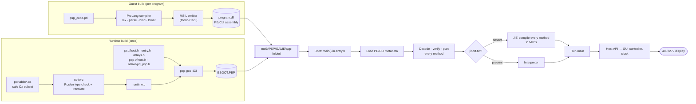

The same `portable/*.cs` source also builds as an ordinary .NET program (`Portable.dll`) with a
headless desktop host. That twin is how the runtime is tested without a PSP. See
[Testing the path](#testing-the-path).

| Stage | What happens | Where |
|---|---|---|
| 1. Compile the guest | ProLang → `program.dll` | `src/ProLang/` |
| 2. Build the runtime | C# → C → MIPS → `EBOOT.PBP` | `runtime/mips-cs/build-psp.ps1`, `cs-to-c/`, `psp/` |
| 3. Boot | Read `program.dll`, pick the engine | `psp/entry.h`, `runtime/psp-v/host.h` |
| 4. Load | PE headers, metadata streams, tables, fields, methods | `Loader`, `Metadata`, `TypeSystem` |
| 5. Prepare | Decode IL, verify stack depths, build plans | `Decoder`, `Natives`, `Verifier`, `Planner` |
| 6. Compile | MIPS for every method, into executable memory | `Jit`, `MipsAssembler`, `RegisterCache`, `psp/host.h` |
| 7. Execute | JIT code or the interpreter, sharing one value stack | `Interpreter`, `Objects`, `Arithmetic`, `Heap` |
| 8. Talk to the PSP | Native calls through the `Host` API to GU and the controller | `Natives`, `psp/host.h`, `native/prl_psp.h` |
| 9. Finish | Flush output, report `PROLANG OK` or `PROLANG FAIL` | `Runtime`, `psp/entry.h` |

All C# classes named above are in `runtime/mips-cs/portable/`.

---

## 1. ProLang source → `program.dll`

The guest is compiled by the normal compiler with its normal .NET backend. Nothing about it is
PSP-specific except that the program calls PSP builtins. The backend is described in detail in
[`dotnet-backend.md`](dotnet-backend.md). The parts that matter here:

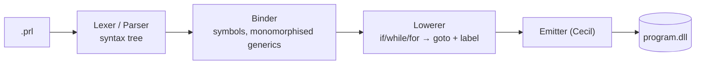

- **One class, static methods.** Every user function becomes a `public static` method of a single
  `Program` class. Structs become sequential-layout value types, and `global` variables become
  static fields. The binder renames `main` to `__UserMain` and synthesises `__Main`, which brackets
  it with `Output.Initialize` and `Output.Flush`.
- **PSP builtins are calls into `ProLang.Runtime.PspOps`.** `psp_fill_rect(10, 20, 50, 50, 0xFF0000)`
  is emitted as five `ldc.i4` and one call:

  ```
  call void [ProLang.Runtime]ProLang.Runtime.PspOps::FillRect(int32, int32, int32, int32, int32)
  ```

  On the CLR, `PspOps` (`src/ProLang.Runtime/PspOps.cs`) throws `PlatformNotSupportedException`.
  On the PSP, the runtime never loads `ProLang.Runtime.dll` at all: it recognises the member
  reference by name and signature and calls the hardware instead (stage 5).
- **The runtime supports a profile, not the whole CLR.** That is 32-bit integers, structs, arrays,
  strings, globals, boxes, capture-free delegates and a whitelist of BCL and `ProLang.Runtime`
  members. Anything outside it fails at load with a named diagnostic, such as
  `unsupported signature type`, rather than misbehaving later. Classes, exceptions, `int64` and
  floating point are not supported.

---

## 2. Portable C# → `EBOOT.PBP`

NativeAOT and Mono cannot target the PSP's MIPS32 Allegrex CPU, and there is no .NET runtime for
it. So the runtime is written in a **restricted, safe subset of C#** that a small translator,
`cs-to-c`, turns into C99. The PSP SDK then compiles that C.

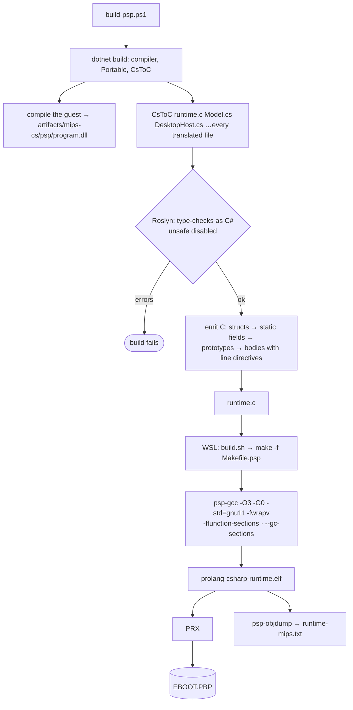

### What the translator produces

`runtime.c` has a fixed shape. The hand-written glue sits on either side of it:

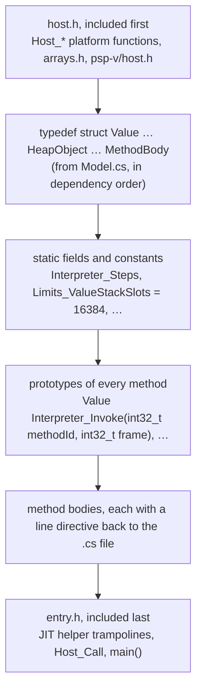

- Names become `Class_Member`, so `Interpreter.Memory` is `Interpreter_Memory`.
- A C# array becomes a pointer just past a length header (`psp/arrays.h`). Every element access
  goes through `pvm_at`, which is bounds-checked; `pvm_at` is forced inline, see stage 7.
- Every C# expression becomes a GNU statement expression, so evaluation order is exactly C#'s.
- `host.h` is included **before** the generated code and `entry.h` **after** it. That is why only
  `entry.h` can use generated names and constants such as `JitAbi_HelperEnter`.

### The platform layers under the runtime

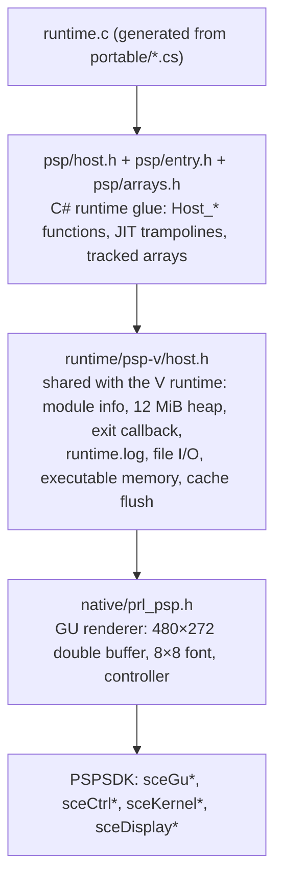

`psp-v/host.h` declares the module (`PSP_MODULE_INFO`), a 512 KiB main-thread stack with VFPU
access, and a 12 MiB C heap (`PSP_HEAP_SIZE_KB(12 * 1024)`). Everything the runtime allocates
comes from that heap.

---

## 3. Boot

The PSP loads `EBOOT.PBP` and calls `main()` in `psp/entry.h`.

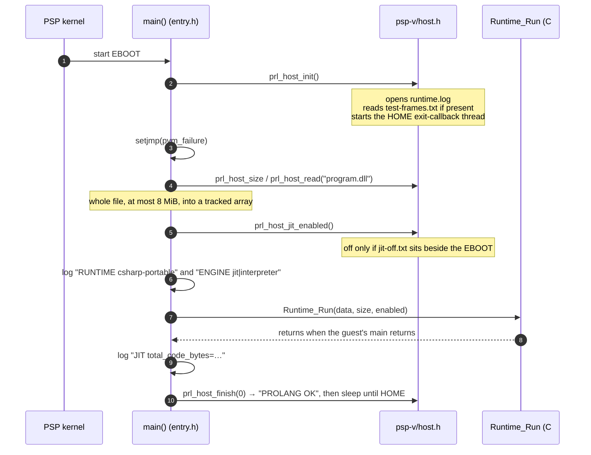

A failure anywhere after `setjmp` arrives back at step 4 through `longjmp`. See [Failure and
exit](#9-failure-and-exit).

---

## 4. Load

`Runtime.Run` (`Runtime.cs`) first resets every class's static state, so a second run in the same
process behaves like a fresh one. Then it calls `Loader.Load`, which is a readable sequence:

```mermaid
flowchart LR
    a["BeginImage"] --> b["ReadPeHeaders<br/>DOS 'MZ', 'PE', optional header,<br/>section table"]
    b --> c["ReadCliHeader<br/>CLI header → metadata root"]
    c --> d["ReadMetadataStreams<br/>'BSJB', #Strings #Blob #US #~"]
    d --> e["ReadTableLayout<br/>row counts, index widths,<br/>row sizes of all 45 tables"]
    e --> f["AllocateMemberTables"]
    f --> g["LoadFields<br/>types, owners, static flag"]
    g --> h["AssignFieldSlots"]
    h --> i["AllocateInterpreterMemory"]
    i --> j["LoadMethods<br/>one MethodBody per MethodDef"]
    j --> k["PrepareMethodBodies<br/>decode + verify all (stage 5)"]
    k --> l["InitializeGlobals<br/>zero value per static field"]
```

- **Every read is checked.** `Metadata` reads the image through a `ByteReader` whose `Consume`
  rejects anything outside the image ("binary read outside image"). RVAs are mapped through the
  section table and checked against it.
- **Field layout.** `TypeSystem` resolves each field's type. Instance fields get a slot index inside
  their record, and static fields get a slot in the globals area.

### The value memory

Guest values live in one array, `Interpreter.Memory`. It is the value stack and the globals.

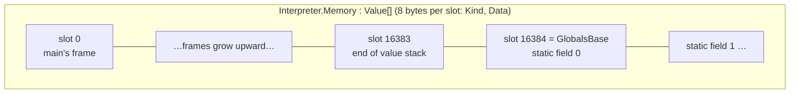

A `Value` is two `int`s: `Kind` (null, int32, string, array, record, address, function pointer,
delegate or box) and `Data`. `Data` is the integer itself, or a **handle**: an index into
`Heap.HandleTable`. No guest value ever holds a native pointer. Strings, arrays, records, boxes,
addresses and delegates are `HeapObject` entries in that table.

---

## 5. Prepare: decode, verify, plan

Every method is prepared at load, before anything runs. A malformed or unsupported program
therefore fails up front.

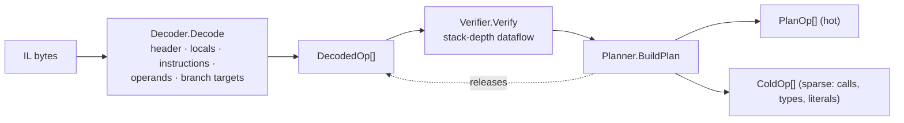

**Decoding** (`Decoder.cs`) reads the tiny or fat method header and the local-variable signature,
then turns each instruction into a `DecodedOp`. It rejects exception sections, opcodes outside the
profile, and methods over the limits (1024 locals, 1024 evaluation-stack slots). Operands are
resolved now, not at run time:

- **Calls** (`ResolveCallSite`): a `MethodDef` becomes a method index. A `MemberRef` to anything
  else goes through `Natives.ResolveNative`, a whitelist matched by namespace, type, name and exact
  signature. `ProLang.Runtime.PspOps::FillRect(int32 ×5)` becomes native id `PspFillRect`. An
  unmatched reference fails with a named error.
- **`ldstr`** becomes a permanent string object, created once.
- **Field tokens** become slot indices. Branch offsets become instruction indices.

**Verifying** (`Verifier.cs`) walks the control flow with a queue. It computes the evaluation-stack
depth at every instruction. It rejects control falling off the end of the method, different depths
meeting at a branch target, argument and local indexes out of range, a stack that underflows or
exceeds `MaxStack`, and a `ret` with the wrong stack.

**Planning** (`Planner.cs`) produces the form both engines execute:

| `PlanOp` field | Meaning |
|---|---|
| `Code`, `Operand` | The opcode, and its resolved operand (target index, slot, constant) |
| `StackSlot` | **Absolute** slot of the stack top, counted from the frame start: args + locals + depth |
| `Flags` | Pop count (bits 0–6), push count (bits 7–8), block start (bit 9), category (bits 10–12) |
| `ColdIndex` | Index into the sparse `ColdOp[]` for calls, types and literals, or 0 |

The category picks a fast path: load argument, load local, store local, small constant, binary
operation, compare-and-branch, or other. Precomputed stack slots mean neither engine tracks a stack
pointer at run time.

---

## 6. Compile to MIPS (the JIT)

Unless `jit-off.txt` is present, `Jit.Compile` translates every method to MIPS once, at load:

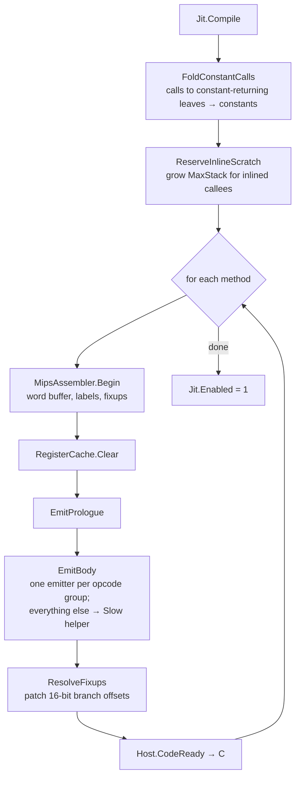

### What the emitted code looks like

**Registers.**

| Register | Role |
|---|---|
| `$s0` | Pointer to this guest frame inside `Interpreter.Memory` |
| `$s1` | Pointer to the caller's result slot |
| `$s2`–`$s7` | Register cache: up to six integer stack slots kept out of memory |
| `$t8`, `$t9` | Scratch, and helper and call targets |
| `$a0`–`$a2`, `$v0` | Helper arguments and result |

**Native stack frame.** Each compiled method opens a 64-byte frame:

| Offset | Contents |
|---|---|
| 60 | `$ra` |
| 56 | `$s0` |
| 52 | `$s1` |
| 48 | unused |
| 44 … 24 | `$s2` … `$s7` |

**Prologue.** It saves those registers, moves the frame and result pointers from `$a0` and `$a1`
into `$s0` and `$s1`, and calls the **Enter** helper.

**Body.** One emitter per opcode group:

- **Native MIPS:** integer arithmetic and comparisons (with divide-by-power-of-two strength
  reduction); argument and local loads and stores; constants (fused with a following arithmetic op);
  `dup`/`pop`/`ldnull`; `ceq` on integers; branches; static fields; `conv` to int; and **direct
  calls** between guest methods.
- **Through a checked helper:** array element access, `ldlen`, and `ldfld`. The register cache
  stays live across these helpers.
- **Through Slow:** everything else, such as natives, `newobj`, strings, boxing and delegates, goes
  through the **Slow** helper. That runs the interpreter's implementation of that single instruction.

Each basic block starts with an **instruction-budget check**. It adds the block's length to the
same counter the interpreter uses and traps past 10,000,000 per frame.

**Calls between compiled methods** need no copying. Arguments already sit at the top of the
caller's evaluation stack. That is where the callee's frame begins, so the callee's frame pointer
is that address. The callee's result is written back to the first argument slot. The call is
indirect, through a fixed slot per method, so forward references work:

```
addiu $a0, $s0, (stackTop - argCount) * 8   ; callee frame = caller's arguments, in place
addiu $a1, $s0, (stackTop - argCount) * 8   ; result goes to the same slot
li    $t9, &pvm_methods[callee]
lw    $t9, 0($t9)
jalr  $t9
nop                                          ; branch delay slot
```

Leaf methods of up to 80 instructions are **inlined** instead, two levels deep.

**Helper contract.** Every helper declares its effects (`Jit.HelperEffects`). Cached integers live
only in `$s2`–`$s7`, so before any helper that reads or writes the frame, allocates or collects,
the cache is **flushed** to memory:

| # | Helper | C trampoline (entry.h) | Effects | Flushes cache |
|---|---|---|---|---|
| 1 | Enter | `pvm_enter` → `Interpreter_Enter` | reads, writes frame | yes |
| 2 | Leave | `pvm_leave` → `Interpreter_Leave` | writes frame | yes |
| 3 | Slow | `pvm_slow` → `Interpreter_Slow` | reads, writes, allocates, collects | yes |
| 4 | Trap | `pvm_trap` (host.h) | never returns | no |
| 5 | Array element | `pvm_array_element` | none | no |
| 6 | Field element | `pvm_field_element` | none | no |
| 7 | Array length | `Objects_ArrayLength` | none | no |

The PSP calling convention preserves `$s2`–`$s7` across calls, which is what lets helpers 5–7 run
without a flush. Control-flow joins also flush when their incoming cache states can differ.

### Publishing the code

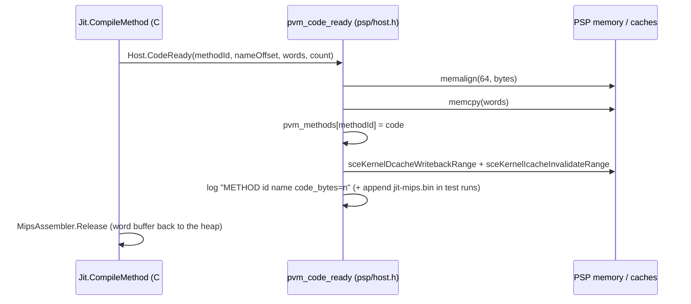

The Allegrex has separate instruction and data caches. Freshly written code must be written back
from the D-cache and invalidated in the I-cache before it runs; that is what
`prl_host_jit_flush` does.

---

## 7. Execute

`Runtime.Run` passes `program.dll`'s `string[] args` as an empty array if `main` takes one. It then
calls `Interpreter.Invoke(entry, 0)`: the entry method's frame starts at slot 0.

### With the JIT

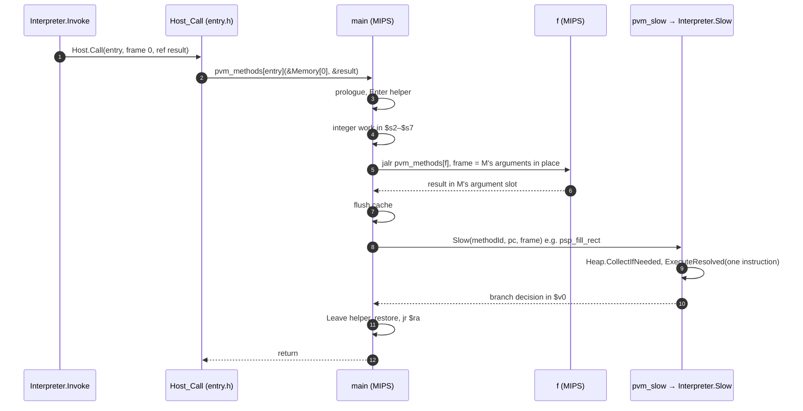

### Without the JIT

`Interpreter.Invoke` runs a loop over the plan. It charges one budget step per instruction, and
handles `ret`, unconditional branches and `brtrue`/`brfalse` inline. Every other instruction first
gives the collector its chance (`Heap.CollectIfNeeded`), then goes to `ExecuteResolved`.
`ExecuteResolved` takes the category fast paths first, then one `switch` over the opcode. A guest
call is a recursive `Invoke` with the callee's frame at the caller's stack top, the same frame
layout the JIT uses.

Both engines share `ExecuteResolved`, which is how the JIT's Slow path reuses the interpreter. That
gives one implementation of every rare instruction, so the two engines cannot drift apart.

`pvm_at`, the bounds-checked accessor behind every translated array access, is marked
`always_inline` in `psp/arrays.h`. Translated functions have external linkage, so GCC's whole-file
inlining budget is spent on cold load-time code. Without the attribute, unrelated refactors changed
whether the interpreter's dispatch inlined it, which moved interpreter speed by about 6%. Forcing it
made the interpreter about 12% faster than before.

### The frame on the value stack

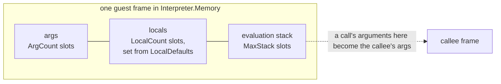

- **Enter** checks the call depth (at most 128) and that the frame fits below slot 16384. It checks
  integer arguments and resets the locals.
- **Leave** clears the whole frame to null, so a finished call keeps nothing alive.

### Memory and the collector

The runtime manages three kinds of memory:

| Memory | Owner | Freed by |
|---|---|---|
| Guest objects (`HeapObject` + their `Values` / `Chars` arrays) | `Heap.HandleTable`, at most 16,383 live (handle 0 means none) | the guest collector |
| Runtime arrays (metadata tables, plans, buffers) | tracked C allocations (`psp/arrays.h`) | `Host.Release*` / reset |
| JIT code | `memalign` in `pvm_code_ready` | never during a run, only on reset |

The guest collector (`Heap.cs`) is a stop-the-world mark and sweep:

- **Trigger:** after 1024 allocations, after 16 KiB, or when no handle is free.
- **When:** only at instruction boundaries. In the interpreter that is before an instruction; in
  JIT code it is inside Slow, after the register cache has been flushed. A collection therefore
  never misses a value that lives only in a register.
- **Roots:** every slot of `Interpreter.Memory` (frames and globals), every permanent object (string
  literals, cached zero values) and the pending output buffer.
- **Handles never move.** A surviving object keeps its handle. A freed handle goes on a free list.

---

## 8. Talking to the PSP

A guest call such as `psp_fill_rect` reaches the hardware like this:

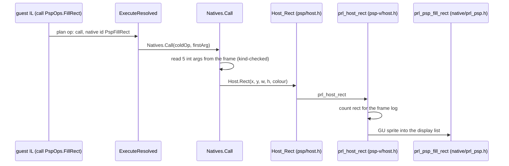

`Natives.Call` covers output (`print`), string operations, `Math`, time and sleep, and the nine PSP
calls: `Init`, `Clear`, `FillRect`, `DrawLine`, `DrawText`, `SwapBuffers`, `Vsync`, `ButtonsHeld` and
`ButtonPressed`. The two delegate ids, `Invoke` and the constructor, never reach it:
`ExecuteResolved` handles them itself, and JIT code reaches them through Slow. Text is UTF-16 in the guest; the host converts it to UTF-8 at
the boundary (`pvm_utf8`).

### A frame

`psp_swap_buffers` is where a frame ends. It also resets the per-frame budget:

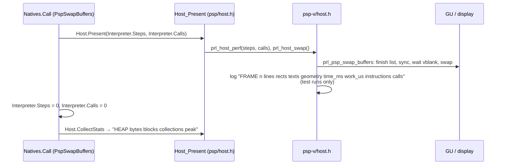

`work_us` is the time from the previous present to this one, before the GE sync and vblank wait. It
is the CPU headroom left in the frame. `geometry` is an FNV-1a hash of every line's endpoints; it
is the correctness oracle compared across engines and builds.

---

## 9. Failure and exit

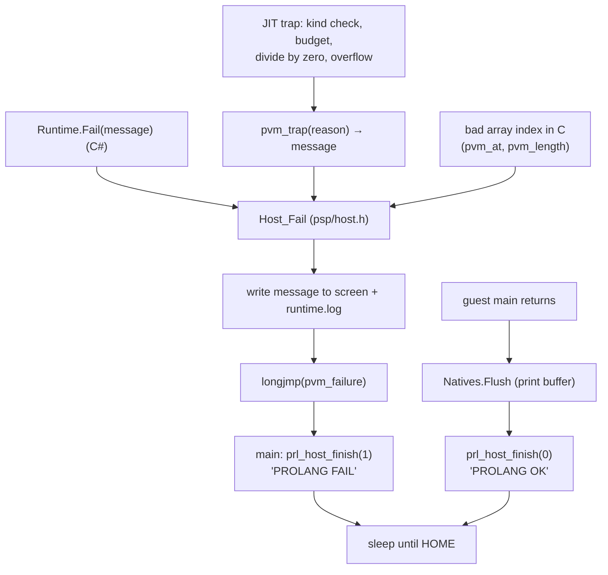

Every check, whether C# (`Runtime.Fail`), C glue or generated MIPS, ends in one place:
`Host_Fail`. Messages are fixed strings that tests match exactly, such as
`array index out of bounds`, `division by zero`, `call depth limit exceeded`,
`instruction budget exceeded` and `unsupported signature type`. Trap reasons are numbers shared
between the JIT and `pvm_trap`, and `AbiTests` pins them.

---

## Files beside the EBOOT

| File | Read or written | Effect |
|---|---|---|
| `program.dll` | read | The guest. Required, at most 8 MiB |
| `jit-off.txt` | read | Present: run the interpreter instead of the JIT |
| `test-frames.txt` | read | A frame count. Enables the FRAME and HEAP lines, `jit-mips.bin` and the first and last frame BMPs, and presses Start at that frame |
| `runtime.log` | written | Always: `RUNTIME`, `ENGINE`, one `METHOD` line per compiled method, program output, `JIT total_code_bytes`, `PROLANG OK`/`FAIL`. In test runs also `FRAME` and `HEAP` |
| `jit-mips.bin` | written (test runs) | Every compiled method's words, concatenated |
| `first-frame.bmp`, `last-frame.bmp` | written (test runs) | Screenshots read back through the GE |

Do not ship `test-frames.txt` or `jit-off.txt` in an interactive package.

---

## Testing the path

The same source runs in three places, each catching different mistakes:

| Where | How | Catches |
|---|---|---|
| Desktop CoreCLR | `Portable.dll program.dll [frames]` with `DesktopHost.cs` (headless, fixed 17 ms clock, interpreter) | Semantics; exact per-frame geometry and instruction counts |
| Desktop JIT capture | `Portable.dll --jit-golden program.dll` with fake host addresses | Any change in the emitted MIPS, word for word, without an emulator |
| PPSSPP / PSP | `build-psp.ps1` then `test-psp.ps1` (with and without `-NoJit`) | Translation, C glue, real JIT execution, caches, timing |

`golden.ps1 -Check` and `compare-psp-logs.ps1 -Strict` turn the first and third into regression
gates. They are described in the README's
[Regression gates](../../runtime/mips-cs/README.md#regression-gates).
